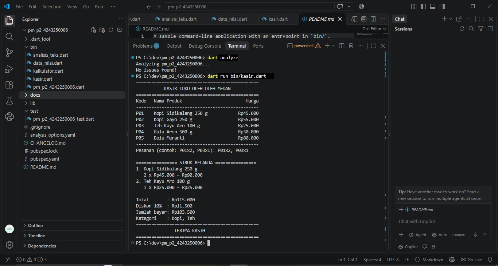
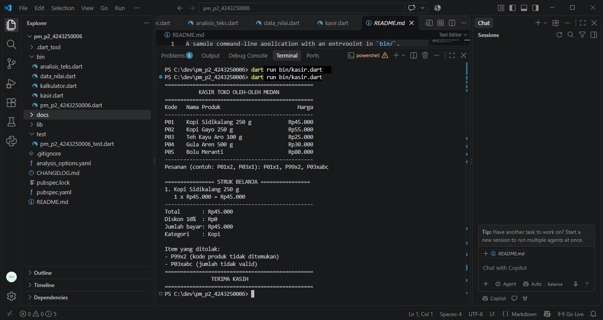

# Tugas Rutin 2 — Aplikasi Console Kasir Sederhana

**Mata Kuliah:** Pemrograman Mobile  
**Pertemuan:** 2 — Dasar Bahasa Dart  
**Dosen Pengampu:** Adidtya Perdana, S.T., M.Kom.

## Identitas Mahasiswa

- **Nama:** Benedict Sandi Pangestu Rosa
- **NIM:** 4243250006
- **Kelas:** PSIK 24 D
- **Program Studi:** S1 Ilmu Komputer
- **Universitas:** Universitas Negeri Medan

## Deskripsi Program

Aplikasi Console Kasir Sederhana merupakan program berbasis bahasa Dart yang dibuat untuk membantu proses perhitungan transaksi pada toko oleh-oleh di Medan.

Program dapat menampilkan katalog produk, menerima pesanan berdasarkan kode barang dan jumlah pembelian, menghitung subtotal, memberikan diskon, serta menampilkan struk belanja. Program juga melakukan validasi apabila pengguna memasukkan kode produk yang tidak tersedia atau jumlah pembelian yang tidak valid.

## Fitur Program

1. Menampilkan katalog yang terdiri dari lima produk.
2. Menerima beberapa pesanan dalam satu baris input.
3. Memvalidasi kode produk dan jumlah pembelian.
4. Menghitung subtotal setiap produk dan total belanja.
5. Memberikan diskon 10% apabila total belanja minimal Rp100.000.
6. Menampilkan struk pembayaran dan kategori produk yang dibeli.
7. Menampilkan daftar pesanan yang ditolak.

## Teknologi

- Bahasa Pemrograman: Dart
- Pengembangan: Visual Studio Code
- Jenis Aplikasi: Console Application
- Struktur Data: Map, List, Set, dan Record

## Cara Menjalankan

Pastikan Dart SDK telah terpasang. Buka terminal pada direktori proyek dan jalankan:

```bash
dart run bin/kasir.dart
```

Untuk memeriksa kode:

```bash
dart format .
dart analyze
```

## Dokumentasi Pengujian

### Skenario 1 — Pesanan Valid

Input: `P01x2, P03x1`

Hasil yang diharapkan:
- Total belanja: Rp115.000
- Diskon 10%: Rp11.500
- Jumlah bayar: Rp103.500
- Kategori: Kopi dan Teh



### Skenario 2 — Pesanan Mengandung Kesalahan

Input: `P01x1, P99x2, P03xabc`

Hasil yang diharapkan:
- Produk P01 berhasil diproses.
- Produk P99 ditolak karena kode tidak ditemukan.
- Produk P03 ditolak karena jumlah tidak valid.
- Jumlah bayar: Rp45.000.



## Penjelasan Variabel dan Null Safety

Dalam pembuatan aplikasi kasir ini, saya mempelajari bahwa `var`, `final`, dan `const` memiliki fungsi yang berbeda dalam mendeklarasikan variabel. `var` digunakan ketika nilai suatu variabel perlu diubah selama program berjalan. `final` digunakan untuk variabel yang hanya ditetapkan satu kali, tetapi nilainya dapat diperoleh saat program dijalankan. Sementara itu, `const` digunakan untuk nilai konstan yang sudah diketahui pada waktu kompilasi.

Pada program kasir, saya menggunakan `final` untuk menyimpan katalog, input pengguna, dan hasil perhitungan yang tidak perlu diganti setelah diberikan nilai. Meskipun referensi katalog menggunakan `final`, isi Map masih dapat dimodifikasi.

Saya juga menerapkan null safety saat membaca input dan mencari produk. Penggunaan `stdin.readLineSync() ?? ''` membantu menangani input yang bernilai null. Selain itu, `int.tryParse()` memungkinkan program memeriksa jumlah pembelian tanpa langsung menimbulkan kesalahan ketika input bukan angka. Hasil pencarian `katalog[kode]` juga diperiksa melalui `if (produk == null)`. Dengan cara ini, pesanan yang tidak valid dapat ditolak tanpa menghentikan keseluruhan program.

## Pernyataan Penggunaan AI

Dalam pengerjaan tugas ini, saya menggunakan ChatGPT sebagai alat bantu untuk memahami materi Dart, mempelajari penerapan struktur data, membantu penyusunan dan peninjauan kode, serta menyiapkan dokumentasi. Program dijalankan dan diuji melalui Visual Studio Code. Saya tetap bertanggung jawab atas pemahaman, hasil pengujian, dan kode yang dikumpulkan.

## Referensi

Adidtya Perdana, S.T., M.Kom. (2026). *Modul Ajar Pemrograman Mobile Pertemuan 2: Dasar Bahasa Dart*. Universitas Negeri Medan.

Dokumentasi resmi Dart: https://dart.dev/
